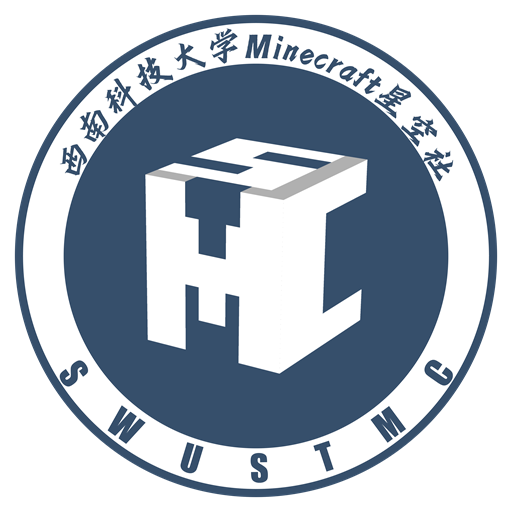

<p align="center">
  
</p>

<h1 align="center">西南科技大学 Minecraft 星空社皮肤站</h1>

<p align="center">
  SWUSTMC Skin · Java 独立皮肤站、3D 衣柜与 authlib-injector 联机认证
</p>

<p align="center">
  Java 21 · SQLite · WebGL 3D · Yggdrasil · Java JAR 插件
</p>

---

## 这是什么

这是西南科技大学 Minecraft 星空社的独立皮肤站。社员可以使用**用户名或邮箱**注册登录，创建多个游戏角色，上传皮肤与披风，在网页里用 3D 查看和换装，再通过 **authlib-injector / Yggdrasil** 把外观带进社团服务器。

项目已完整迁移到 Java：使用 JDK 自带的 `com.sun.net.httpserver` 与虚拟线程处理请求，SQLite 持久化，Jackson 处理 JSON，BCrypt 存储密码，不依赖 Spring、PHP、MongoDB、Redis 或对象存储。前端仍是无需构建的原生 ES Module 单页应用。

## 功能

| 模块 | 能力 |
| --- | --- |
| 账号 | 用户名 / 邮箱登录、邮箱验证码注册、会话、CSRF、登录限流、停用 / 启用、改邮箱、改密码 |
| 权限 | 系统角色、部门、权限目录、等级权重、系统角色保护、角色分配、用户额外权限 |
| 角色 | 一人多角色（上限 10）、32 位角色 UUID、经典 / 纤细模型、重命名、删除、装备皮肤与披风 |
| 材质 | PNG 结构与尺寸校验、SHA-256 去重、公开 / 私有、上传、下载、编辑、删除 |
| 皮肤库 | 公开浏览、搜索、类型筛选、排序、分页、3D 详情、收藏到衣柜 |
| 衣柜 | 收藏、重命名、移除、装备、下载 |
| 3D | 纯 WebGL 角色渲染，支持皮肤、披风、叠层、旋转、缩放、自动旋转、2D 降级 |
| 联机 | Yggdrasil 认证、刷新、校验、登出、session join / hasJoined、RSA 材质签名、authlib-injector 元数据 |
| 插件 | 目录扫描、JAR / ZIP 安装、启用 / 停用、热重载、卸载、Java 服务端路由与事件钩子、前端远程模块 |
| 管理 | 白色工作台布局与可折叠分类侧栏；用户、角色权限、额外权限、角色档案、材质、插件、API 密钥、站点文案与开关；用户数据导出 |
| 外部集成 | 用户级 API 密钥，权限范围、有效期、最近使用时间、随时撤销；支持 Bearer / X-API-Key |
| 品牌 | 星空社徽章、深海军蓝 / 星金配色、响应式首页、社团文案与联机指引 |
| 首页 | 管理后台可上传多张首页主图（PNG / JPG / WebP，最多 8 张）并自动循环滚动、支持左右箭头切换；未上传时使用社团徽章占位；登录后展示可拖入 PCL2 / HMCL 的认证卡片 |

内置两个示例插件：

- **服务器状态**：Java 插件，真实 TCP 探测服务器在线状态与延迟，管理员可在页面内维护服务器地址。
- **随机皮肤**：纯前端插件，从公开皮肤库随机抽 9 件作品。

## 快速开始

要求：**JDK 21+**、**Maven 3.9+**。

```bash
# 1. 构建
mvn -DskipTests package

# 2. 可选：准备环境变量
cp .env.example .env

# 3. 启动
java -jar target/swust-skin.jar
```

Windows 可以直接双击或在终端运行：

```bat
run.bat
```

Linux / macOS：

```bash
./run.sh
```

打开 <http://localhost:3000>。首次启动会自动创建 SQLite 数据库、管理员与基础权限数据。

Windows 下如果需要让局域网启动器访问，请把 `.env` 里的 `BASE_URL` 改成电脑的局域网地址，例如：

```env
BASE_URL=http://192.168.1.20:3000
```

### 默认账号

| 角色 | 用户名 | 邮箱 | 密码 |
| --- | --- | --- | --- |
| 管理员 | `admin` | `admin@example.com` | `swustmc2026` |
| 演示社员 | `xingkong` | `xingkong@example.com` | `swust123` |
| 演示社员 | `beichen` | `beichen@example.com` | `swust123` |
| 演示社员 | `yunduo` | `yunduo@example.com` | `swust123` |
| 演示社员 | `orion` | `orion@example.com` | `swust123` |

> 正式部署前务必修改管理员密码，并删除或停用演示账号。Git 仓库不包含 `data/`、数据库、RSA 密钥或用户上传文件；全新克隆首次启动只会创建管理员与系统角色。上表演示账号来自现有部署数据。

## 首页主图与联机卡片

管理员可在「管理后台 → 站点设置 → 首页主图」上传多张 PNG / JPG / WebP 图片（单张最大 8MB，最多 8 张），首页右侧会按上传顺序自动循环滚动播放，也可用左右箭头手动切换；全部移除后自动回退为社团徽章。文件按内容哈希存放在 `data/branding/`，移除时会清理对应文件。

登录后，首页按钮下方会显示 authlib-injector 认证卡片。把卡片直接拖到 PCL2 / HMCL 窗口即可添加认证服务器；也可以点击复制按钮手动填写。

## 环境变量

| 变量 | 默认值 | 说明 |
| --- | --- | --- |
| `HOST` | `0.0.0.0` | 监听地址 |
| `PORT` | `3000` | 监听端口 |
| `BASE_URL` | `http://localhost:<PORT>` | 对外访问地址，**Yggdrasil 材质 URL 与签名域名依赖它** |
| `DATA_DIR` | `./data` | SQLite、材质文件、RSA 密钥目录 |
| `PLUGINS_DIR` | `./plugins` | 插件目录 |
| `ADMIN_USERNAME` | `admin` | 首次启动创建的管理员用户名 |
| `ADMIN_EMAIL` | `admin@example.com` | 首次启动创建的管理员邮箱 |
| `ADMIN_PASSWORD` | `swustmc2026` | 首次启动创建的管理员密码 |
| `SNOWFLAKE_DATA_CENTER_ID` | `1` | 雪花 ID 数据中心号（0–31） |
| `SNOWFLAKE_MACHINE_ID` | `1` | 雪花 ID 机器号（0–31）；多实例部署时需保证组合唯一 |
| `TRUST_PROXY` | `0` | 位于 Nginx / Caddy 后时设为 `1`，读取 `X-Forwarded-For` |
| `MAIL_ENABLED` | `0` | 设为 `1` 后注册必须完成邮箱验证码 |
| `MAIL_HOST` | 空 | SMTP 服务器，例如 `smtpdm.aliyun.com` |
| `MAIL_PORT` | `465` | SMTP 端口 |
| `MAIL_SSL` | `1` | 端口 465 使用 SSL 时保持 `1` |
| `MAIL_USERNAME` | 空 | SMTP 登录用户名，通常是完整发信地址 |
| `MAIL_PASSWORD` | 空 | SMTP 专用密码，不要使用账号登录密码 |
| `MAIL_FROM` | 同 `MAIL_USERNAME` | 发信地址 |
| `MAIL_FROM_NAME` | `星空社皮肤站` | 发件人显示名称 |

`.env` 与系统环境变量同时存在时，系统环境变量优先。

启用 `MAIL_ENABLED=1` 后，注册页会发送 6 位邮箱验证码，验证码 10 分钟内有效，同一邮箱 120 秒后可重发；同一邮箱 10 分钟内最多发送 5 次。SMTP 密码只应保存在 `.env`，不要提交到仓库。

## 数据、备份与迁移

运行数据都在 `DATA_DIR`：

```text
data/
├── swustmc.db              SQLite 数据库
├── textures/               上传的 PNG 材质
└── keys/                   Yggdrasil RSA 私钥与公钥
```

备份时请整体备份 `data/`，尤其是 `data/keys/`。更换服务器后必须保留同一对密钥，否则启动器缓存的材质签名会失效。

### 角色 UUID 规则

角色 UUID 由站点命名空间与角色名生成：

```text
UUID.nameUUIDFromBytes(("SWUSTMCSkin:" + name.toLowerCase()).getBytes(UTF_8))
```

去掉连字符后输出 32 位小写十六进制。角色改名保留原 UUID，避免服务器玩家数据失效。启动时会把旧数据中的角色 UUID 迁移到该命名空间，并清理旧的 Yggdrasil token 与 join 记录。

### 用户数据导出

管理员可在「站点设置 → 用户数据导出」下载，或直接访问：

```text
GET /api/admin/export
```

文件包含 `sysUser`、`sysRole`、`sysDept`、`sysPermission` 四个集合；Long 类型 ID 以十进制字符串输出，密码为 BCrypt，可直接映射到使用相同字段结构的外部用户中心。

## 联机认证（authlib-injector）

站点实现了 Yggdrasil 兼容端点，入口为：

```text
${BASE_URL}/api/yggdrasil
```

在 HMCL / PCL2 等启动器中添加「认证服务器」，地址填上面的 URL，然后使用本站**用户名或邮箱 + 密码**登录。启动器会请求站点的 `authserver`、`sessionserver` 端点，并读取带 RSA-SHA256 签名的 `textures` 属性。

服务端建议保持离线模式（`online-mode=false`），玩家 ID 与站内角色名保持一致。

> `BASE_URL` 必须是启动器可访问的地址；`localhost` 只适合本机测试。公网部署请使用 HTTPS 域名，并确保服务器能访问 `/textures/<hash>.png`。

## 用户额外权限

角色权限之外，管理员可以在「用户管理 → 编辑用户 → 额外权限」中给单个用户追加权限。额外权限是**增量授权**：不会覆盖或删除角色继承的权限，用户最终权限为「角色权限 ∪ 额外权限」。角色继承的权限在弹窗中显示为勾选且不可取消，额外权限可单独勾选或取消。

接口：

```text
PUT /api/admin/users/:id/permissions
{ "permissions": ["skin:texture:view", "plugin:server-status:use"] }
```

管理员只能授予自己当前拥有的权限；通配权限 `*` 不能直接授予单个用户。

## API 密钥

管理后台左侧「插件与扩展 → API 密钥」可以为用户签发外部集成密钥。密钥只在创建时显示一次，数据库只保存 SHA-256 哈希与可识别前缀。

- 请求头：`Authorization: Bearer sk_...` 或 `X-API-Key: sk_...`
- 权限范围：用户全部权限 / 仅插件权限 / 仅查看权限，创建时固化为权限码列表。
- 有效期：30 / 90 / 365 天或永久；可随时撤销。
- 可访问：公开查询接口、材质读取、插件接口。
- 不可访问：管理后台、账号与登录、玩家与衣柜等用户私有接口，以及所有非白名单写入操作。
- API 密钥按用户当前有效权限求交集，角色或额外权限被收回后，密钥权限同步缩小。

## 插件权限

每个已安装插件会自动注册一个权限码：

```text
plugin:<插件 id>:use
```

它会出现在「角色管理 → 权限 → 插件权限」中，用于控制插件页面与插件接口的访问。新插件首次注册时默认授予管理员、普通用户与访客角色，保持安装后立即可用；管理员可以按角色收回。插件被卸载时，对应权限会从权限目录、所有角色和用户额外权限中移除。

### 后台侧栏分类

管理后台左侧栏按「工作台 / 用户与权限 / 皮肤站 / 插件与扩展 / 系统」分类；已启用插件会自动出现在「插件页面」分类，也可以由插件清单声明自己的后台入口与分类：

```json
{
  "adminNav": [
    {
      "title": "服务器管理",
      "category": "社团服务",
      "icon": "server",
      "path": "#/plugin/server-status",
      "order": 10
    }
  ]
}
```

`path` 必须是以 `#/` 开头的站内路由；省略时默认指向插件页面。

## Java 插件开发

插件放在 `plugins/<id>/`，也可以由管理员在「管理后台 → 插件管理」上传 **JAR** 或 ZIP。插件包根目录需要 `plugin.json`：

```json
{
  "id": "my-plugin",
  "name": "我的插件",
  "version": "1.0.0",
  "description": "插件说明",
  "author": "作者",
  "mainClass": "com.example.MyPlugin",
  "client": "client.mjs",
  "nav": { "title": "页面", "icon": "sparkles", "order": 50 }
}
```

- `mainClass`：实现 `cn.edu.swust.mc.skin.plugin.SkinPlugin` 的 Java 类，必须有无参构造器。
- `client`：可选的浏览器端 ES Module，导出 `mount(root, ctx)` 后即可出现在导航与插件页面。
- `nav`：可选导航项；没有 `nav` 的插件只在管理后台显示。
- `enabledByDefault`：首次扫描时是否默认启用。

服务端入口示例：

```java
package com.example;

import cn.edu.swust.mc.skin.plugin.PluginContext;
import cn.edu.swust.mc.skin.plugin.SkinPlugin;

import java.util.LinkedHashMap;
import java.util.Map;

public final class MyPlugin implements SkinPlugin {
    @Override
    public void activate(PluginContext ctx) {
        ctx.registerRoute("GET", "/hello", request -> {
            Map<String, Object> data = new LinkedHashMap<>();
            data.put("message", "hello");
            data.put("user", request.user() == null ? null : request.user().username);
            return data;
        });
    }
}
```

可用能力：

- `ctx.registerRoute(method, path, handler)`：注册 `/api/plugins/<id><path>`。
- `ctx.registerAdminRoute(...)`：仅管理员可访问。
- `ctx.on(event, handler)`：监听 `texture.uploaded`、`player.created`、`player.equipped` 等事件。
- `ctx.getConfig()` / `ctx.setConfig(patch)`：读取与保存插件配置。
- `ctx.getData(key)` / `ctx.setData(key, value)`：插件私有持久化数据。
- `ctx.stats()` / `ctx.settings()` / `ctx.listPublicTextures(query)`：只读访问站点数据。

构建 JAR：

```bash
javac --release 21 -cp target/swust-skin.jar -d build src/com/example/MyPlugin.java
cp plugin.json build/
cd build && jar --create --file ../my-plugin.jar .
```

`plugin-src/hello-plugin/` 提供了一个可安装的最小示例，构建产物为 `plugin-src/hello-plugin/hello-plugin.jar`。

> 插件拥有宿主进程内的执行权限，只安装可信来源的插件。需要第三方库时请打成 shaded JAR，或把依赖随插件一起放入插件目录。

## 部署

### 直接运行

```bash
mvn -DskipTests package
BASE_URL=https://skin.example.com PORT=3000 java -jar target/swust-skin.jar
```

建议用 systemd 托管：

```ini
[Unit]
Description=SWUSTMC Skin
After=network.target

[Service]
WorkingDirectory=/opt/swust-skin
Environment=BASE_URL=https://skin.example.com
Environment=PORT=3000
Environment=TRUST_PROXY=1
ExecStart=/usr/bin/java -jar /opt/swust-skin/target/swust-skin.jar
Restart=always
User=swustskin

[Install]
WantedBy=multi-user.target
```

### Nginx 反向代理

```nginx
server {
    listen 443 ssl http2;
    server_name skin.example.com;

    ssl_certificate     /etc/letsencrypt/live/skin.example.com/fullchain.pem;
    ssl_certificate_key /etc/letsencrypt/live/skin.example.com/privkey.pem;

    client_max_body_size 40m;

    location / {
        proxy_pass http://127.0.0.1:3000;
        proxy_set_header Host $host;
        proxy_set_header X-Real-IP $remote_addr;
        proxy_set_header X-Forwarded-For $proxy_add_x_forwarded_for;
        proxy_set_header X-Forwarded-Proto $scheme;
    }
}
```

同时设置 `TRUST_PROXY=1`，并把 `BASE_URL` 写成 `https://skin.example.com`。

### 域名与备案

- 中国大陆服务器使用 80 / 443 对外提供网站服务通常需要完成 ICP 备案；未备案域名可能被接入商拦截。
- 没有备案时，可把站点部署到香港或海外服务器，或先完成备案后再切换。
- 用 8443 等高位端口只能作为临时测试方案，不适合作为长期公开服务。
- 无论部署在哪里，都建议启用 HTTPS，并定期备份 `data/`。

### Docker

```bash
docker build -t swust-skin .
docker run -d --name swust-skin \
  -p 3000:3000 \
  -e BASE_URL=https://skin.example.com \
  -v "$PWD/data:/app/data" \
  -v "$PWD/plugins:/app/plugins" \
  swust-skin
```

## 安全清单

1. 修改默认管理员密码，停用演示账号。
2. 设置正确的 `BASE_URL`，公网使用 HTTPS。
3. 不要泄露 `data/keys/yggdrasil-private.pem`。
4. 只安装可信插件；插件拥有服务端执行权限。
5. 定期备份 `data/`，升级前先备份数据库与密钥。
6. 反向代理后设置 `TRUST_PROXY=1`，不要直接把应用端口暴露到公网。

## 项目结构

```text
src/main/java/cn/edu/swust/mc/skin/
├── Main.java                HTTP 服务与请求分发
├── Web.java                 路由、请求/响应、静态资源、限流
├── Auth.java                会话、CSRF、权限校验
├── Authz.java               角色、部门、权限模型
├── Database.java            SQLite 初始化与迁移
├── Textures.java            PNG 校验、材质与衣柜
├── Players.java             角色与装备
├── Yggdrasil.java           联机认证与 RSA 签名
├── Plugins.java             Java JAR 插件运行时
├── Branding.java            首页主图校验、存储与切换
├── ApiKeys.java             API 密钥签发、校验与权限收敛
├── routes 相关类            认证、皮肤、管理、插件、首页
├── plugins/serverstatus/    服务器状态示例插件
└── plugin/                  插件 API

public/                      无需构建的前端
plugins/                     运行中的示例插件
plugin-src/                  示例插件源码
data/                        SQLite、材质与密钥
```

## 第三方组件

3D 皮肤预览使用 [skinview3d](https://github.com/bs-community/skinview3d) 3.4.2（MIT License），以 UMD bundle 形式随站点发布，许可证见 `public/assets/vendor/skinview3d.LICENSE`。

## 许可证

见 [LICENSE](LICENSE)。
